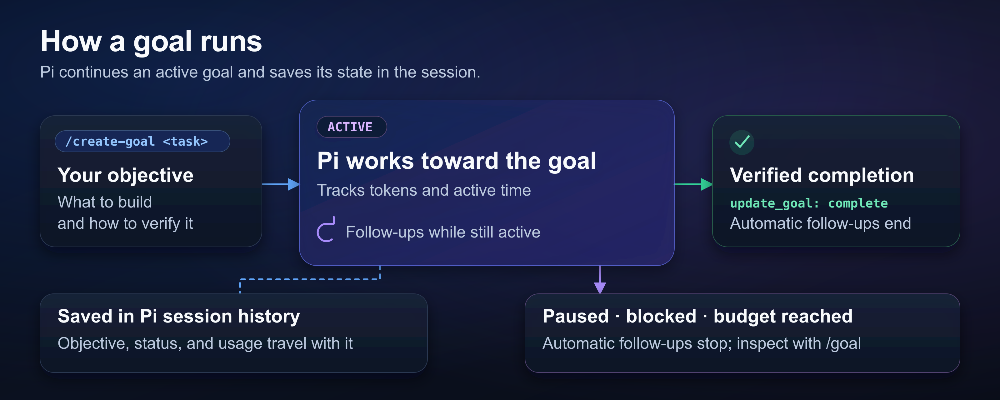

# pi-codex-goal

pi-codex-goal adds a persistent goal to [Pi](https://github.com/earendil-works/pi). The extension prompts Pi to continue an active goal across turns.



## Install and start

Use Pi 1.0.0 or later and Node.js 24 or later. The extension supports official Pi releases and the [fitchmultz Pi fork](https://github.com/fitchmultz/pi).

This copy is maintained in dotfiles at `tools/pi-codex-goal`.
Dotfiles setup links it to `~/.pi/agent/packages/pi-codex-goal`; Pi settings load `./packages/pi-codex-goal`, including its extensions and prompts.
Do not add a separate npm, Git, or project-local install of the same package.
Start `pi` after setup.

Run `/reload` if Pi is already open. Enter a task in the Pi editor:

```text
/create-goal Add CSV export to the reports page. Test the export. Document its use.
```

`/create-goal` expands your task into an objective with completion checks. The new goal replaces the old one. Include every requirement you want to keep.

## Goal controls

| Command | Action |
| --- | --- |
| `/goal` | Show the objective, status, token budget, usage, and active time. |
| `/goal <objective>` | Set the exact objective. Confirm replacement of an unfinished goal. |
| `/goal pause` | Pause an active or blocked goal. |
| `/goal resume` | Continue a paused, blocked, or completed goal with its existing usage and budget. |
| `/goal resume cancel` | Cancel a scheduled provider-limit retry. |
| `/goal copy` | Copy the objective to the system clipboard. |
| `/goal edit` | Edit the objective without resetting or resuming the goal. |
| `/goal clear` | Remove the current goal. |

Press Esc to stop the current assistant turn and pause its active or blocked goal.

A blocked goal needs input or external work.
Run `/goal` to read the reason.
After new information resolves the dependency, the agent can explicitly reactivate it with `update_goal`; you can also use `/goal resume`.
Use `/goal pause` to prevent agent reactivation.

Completed goals stay complete. Create a new goal for more work.

## Limits and cost

Active goals cause extra model calls. Use `/goal pause` to stop automatic continuation.

New goals have no token limit. Ask the agent to set `token_budget` through `create_goal` to limit a goal. The default minimum is 500,000 tokens. The goal stops automatic continuation when it reaches the budget.

Goal tokens count assistant input and output. This count excludes provider cache accounting and host maintenance costs. It does not show total provider charges.

## Sessions and recovery

The goal survives resume, reload, fork, tree navigation, and compaction. The Pi footer shows goal status and usage when a UI is available.

Pi controls compaction. The extension uses bounded retries for transient provider errors. Recognized provider usage limits can schedule an automatic retry.

## Headless use

Ask the agent to use `create_goal`, `get_goal`, and `update_goal` for headless runs.

`pi -p '/goal …'` runs the command and can change saved goals. Print mode can exit before the goal turn finishes and leave the goal paused.

## Details

Read the [reference](docs/reference.md) for installation options, budget policy, tools, and recovery.

Read the [development guide](docs/development.md) for checks, compatibility qualification, smoke tests, and releases.

See the [changelog](CHANGELOG.md) for version history. Report problems in [Issues](https://github.com/fitchmultz/pi-codex-goal/issues).

## Source provenance

History was imported into dotfiles with `bin/transplant-commits` on October 31, 2026, from the standalone `pi-codex-goal` repository.
The committed source revision is `9fb0751dbfc30ceef480105c5c2296ae581730e2`, “Document runtime harness state and lifecycle semantics”.
The import includes 169 non-merge commits; 32 merge commits were omitted.
The upstream project is [fitchmultz/pi-codex-goal](https://github.com/fitchmultz/pi-codex-goal), version 0.6.1.
Its license, changelog, source, tests, prompts, and historical release workflows remain here; the nested workflows are provenance, not dotfiles release automation.
Dotfiles owns installation of this copy; upstream release instructions describe the independent upstream package.
Goal state stays in Pi session custom entries; this move does not copy, reset, or migrate sessions or runtime state.

## License

[Mitch Fultz](https://github.com/fitchmultz) publishes this project under the [MIT license](LICENSE).
